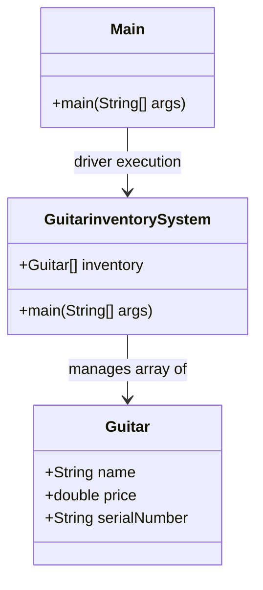

# 🎸 Guitar Inventory System (GIS) — Java OOP Model

A modular Java application modeling an instrument retail inventory system, demonstrating Object-Oriented Programming (OOP) principles, custom class structures, property encapsulation, and inventory array management.

---

## 📌 Project Overview

The **Guitar Inventory System** provides a structured demonstration of core Java concepts:
- **Object Modeling:** The `Guitar` entity represents real-world instrument attributes (brand, model, price, serial specifications).
- **Inventory Collection Management:** Employs an array-based inventory structure (`Guitar[]`) managed via `GuitarinventorySystem` to insert, store, and manipulate guitar objects.
- **Console I/O:** Interacts directly with the user via system console input routines to record new stock.

---

## 🏗️ Architecture & Class Design



---

## 📂 Repository Structure

```text
gis-java/
├── Guitar.java                  # Guitar entity definition and attributes
├── GuitarinventorySystem.java   # Inventory array initialization and input loop
├── Main.java                    # Entry point driver class
├── IMG_20250318_145701.jpg      # Lab demonstration reference image
└── README.md                    # Project documentation
```

---

## ⚙️ Compilation & Execution

### Prerequisites
- Java Development Kit (JDK 8 or higher)

### Steps to Run:

1. **Clone the repository:**
   ```bash
   git clone https://github.com/prakruthidevanga/gis-java.git
   cd gis-java
   ```

2. **Compile the source files:**
   ```bash
   javac *.java
   ```

3. **Run the inventory system:**
   ```bash
   java GuitarinventorySystem
   ```

---

## 🛠️ Technology Stack

- **Language:** Java (JDK 8+)
- **Concepts:** Object-Oriented Programming (OOP), Array Data Structures, Console Input / Output

---

## 👩‍💻 Author & Contributions

- **Author:** Prakruthi B R ([@prakruthidevanga](https://github.com/prakruthidevanga))
- **Program:** BCA (Specialization in Artificial Intelligence and Machine Learning), Alliance University.
- **Contributions:** Implemented the OOP object hierarchy, inventory allocation arrays, and interactive input processing.
